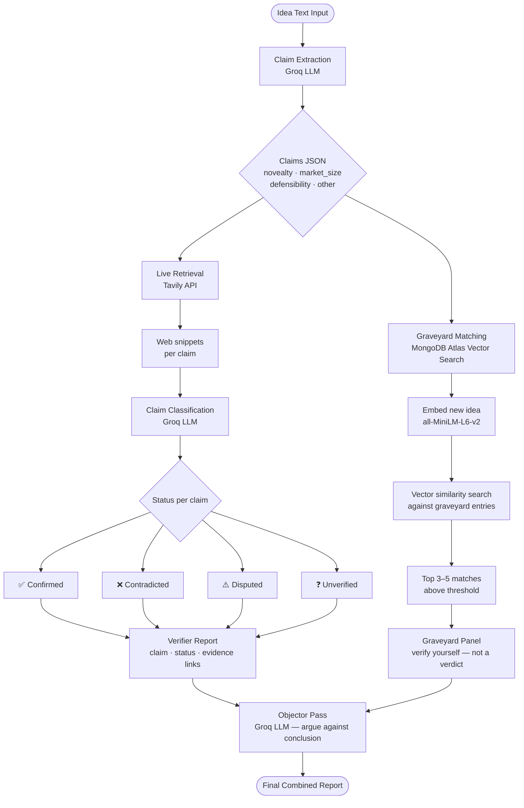

# VistaDex — LLM Pipeline Architecture
### Kushagra's ownership: Claim Extraction · Live Retrieval · Matching Engine

---

## Stack at a glance

| Component | Tool | Cost |
|---|---|---|
| LLM (extraction + classification) | Groq API — `llama-3.3-70b-versatile` | Free tier |
| Live web retrieval | Tavily API | Free tier (1000 searches/mo) |
| Structured company data | Crunchbase public API | Free basic lookups |
| Embeddings | `all-MiniLM-L6-v2` (Sentence Transformers) | Free, runs locally |
| Vector store + DB | MongoDB Atlas | Free tier |

---

## Full pipeline flow



---

## Stage 1 — Claim Extraction

**Input:** raw idea text submitted by a founder / applicant

**Output:** JSON array of individual, checkable claims

**How it works:** a structured prompt sent to Groq instructs the LLM to decompose the idea into atomic, falsifiable statements. Each claim is tagged with a type so the retrieval step knows how to search for it.

```python
from groq import Groq

client = Groq(api_key="your_key")

EXTRACTION_PROMPT = """
You are a claim extraction system. Given a startup idea, extract every 
individual factual claim that could be verified against external evidence.

A valid claim must be:
- A single, checkable statement (not compound)
- Falsifiable — true or false in the real world
- Specific enough to search for

Return ONLY a JSON array, no other text:
[{"claim": "...", "type": "novelty|market_size|defensibility|other"}]

Idea: {idea_text}
"""

def extract_claims(idea_text: str) -> list[dict]:
    response = client.chat.completions.create(
        model="llama-3.3-70b-versatile",
        messages=[{"role": "user", "content": EXTRACTION_PROMPT.format(idea_text=idea_text)}],
        response_format={"type": "json_object"}
    )
    return response.choices[0].message.content
```

---

## Stage 2 — Live Retrieval + Classification

**Input:** each individual claim from Stage 1

**Output:** claim status (`confirmed / contradicted / disputed / unverified`) with evidence links

**How it works:** Tavily searches the web for each claim and returns clean text snippets. Those snippets + the original claim go back to Groq for classification.

```python
from tavily import TavilyClient

tavily = TavilyClient(api_key="your_key")

def retrieve_evidence(claim: str) -> list[str]:
    results = tavily.search(
        query=claim,
        search_depth="advanced",
        max_results=5
    )
    return results["results"]  # list of {title, url, content}

CLASSIFICATION_PROMPT = """
You are a fact-checking system. Given a claim and web evidence, classify the claim.

Claim: {claim}

Evidence:
{evidence}

Reply with ONLY a JSON object:
{{"status": "confirmed|contradicted|disputed|unverified", "reasoning": "one sentence", "source_urls": ["..."]}}
"""

def classify_claim(claim: str, evidence: list) -> dict:
    evidence_text = "\n\n".join([f"- {r['content']} ({r['url']})" for r in evidence])
    response = client.chat.completions.create(
        model="llama-3.3-70b-versatile",
        messages=[{"role": "user", "content": CLASSIFICATION_PROMPT.format(
            claim=claim, evidence=evidence_text
        )}],
        response_format={"type": "json_object"}
    )
    return response.choices[0].message.content
```

---

## Stage 3 — Graveyard Matching Engine

**Input:** the submitted idea (full text)

**Output:** top 3–5 past startups that tried something similar, framed as leads

**How it works:** each graveyard entry is stored in MongoDB Atlas with a vector embedding of the `what_they_tried` field. The new idea is embedded and searched against those vectors. This is the same RAG setup as the MongoDB project — different corpus, same mechanism.

### MongoDB document schema
```json
{
  "company_name": "Atrium",
  "what_they_tried": "AI-powered legal services platform for startups, automating contract review and legal advice",
  "cause_of_death": "Unit economics — cost of human lawyer oversight made scaling impossible",
  "sources": ["https://techcrunch.com/...", "https://failory.com/..."],
  "year_closed": 2020,
  "embedding": [0.023, -0.14, ...]
}
```

### Matching code
```python
from sentence_transformers import SentenceTransformer
from pymongo import MongoClient

model = SentenceTransformer("all-MiniLM-L6-v2")
mongo = MongoClient("your_atlas_uri")
collection = mongo["vistadex"]["graveyard"]

def match_graveyard(idea_text: str, top_k: int = 5) -> list[dict]:
    idea_embedding = model.encode(idea_text).tolist()

    results = collection.aggregate([{
        "$vectorSearch": {
            "index": "graveyard_vector_index",
            "path": "embedding",
            "queryVector": idea_embedding,
            "numCandidates": 50,
            "limit": top_k
        }
    }])

    return list(results)
```

---

## Stage 4 — The Objector Pass

**Input:** the full Verifier report + graveyard matches

**Output:** a set of counter-arguments before anything is shown as final

**How it works:** a separate Groq call, with a prompt specifically instructed to argue *against* the system's conclusion. Counters AI sycophancy — the model is not allowed to agree.

```python
OBJECTOR_PROMPT = """
You are the Objector. Your only job is to argue AGAINST the conclusion below.
Find every reason the system might be wrong. Be specific and cite gaps in the evidence.

Verifier conclusion:
{verifier_report}

Graveyard matches:
{graveyard_matches}

Return a JSON array of objections:
[{"objection": "...", "severity": "high|medium|low"}]
"""
```

---

## Build order (course deadline)

| Week | What to ship | What it proves |
|---|---|---|
| **1** | Claim extraction end-to-end | Input idea → JSON claims list. Demoable on its own. |
| **1–2** | Tavily retrieval + Groq classification | Full Verifier working — each claim gets a status + evidence. |
| **2+** | Seed graveyard (~50 entries), embed, load Atlas | Matching engine live — same RAG stack as MongoDB project. |
| **2+** | Objector pass | Wrap the pipeline end-to-end into one combined report. |

---

## Interfaces with other teammates

| What you hand off | To whom | Format |
|---|---|---|
| Final combined report (JSON) | **Richeek** (UI/UX) | `{claims: [...], graveyard_matches: [...], objections: [...]}` |
| Graveyard DB schema + embedding pipeline | **Lakshit** (entity resolution, tagging) | MongoDB collection + embedding script |
| API design for idea submission | **Aditya** (overall architecture) | Simple REST endpoint — `POST /screen {idea_text}` |
